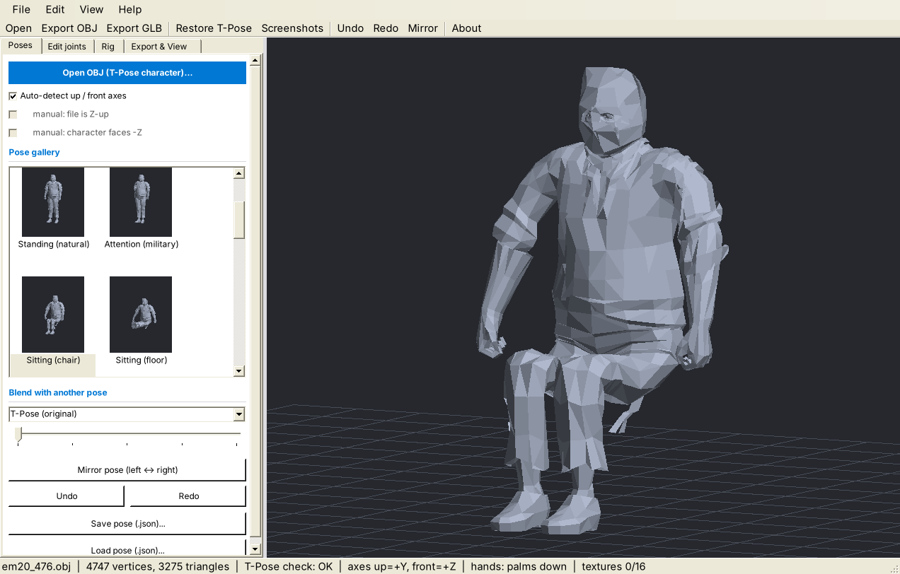
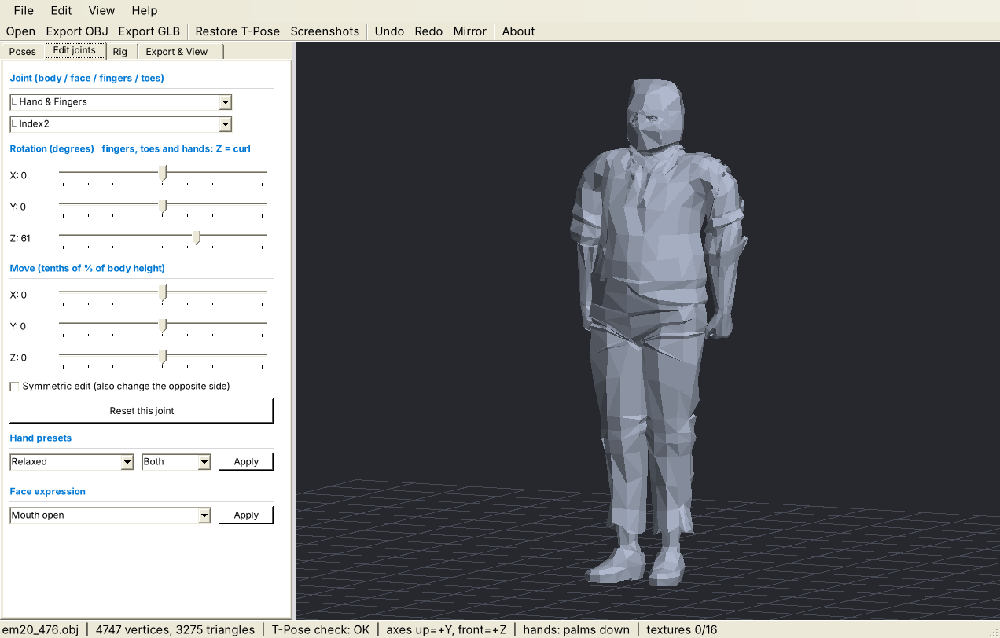
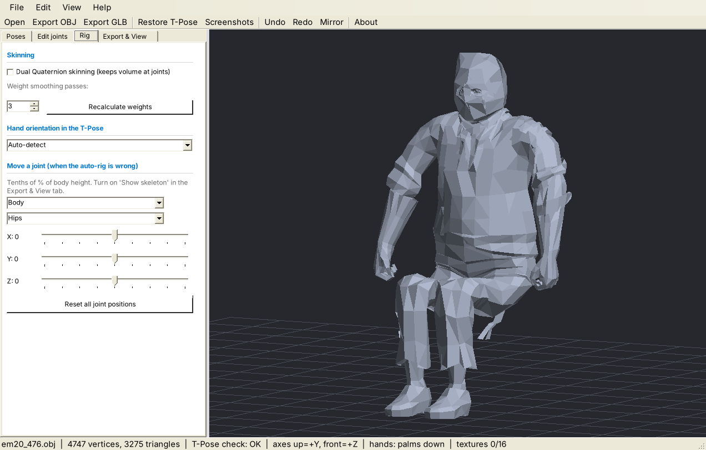
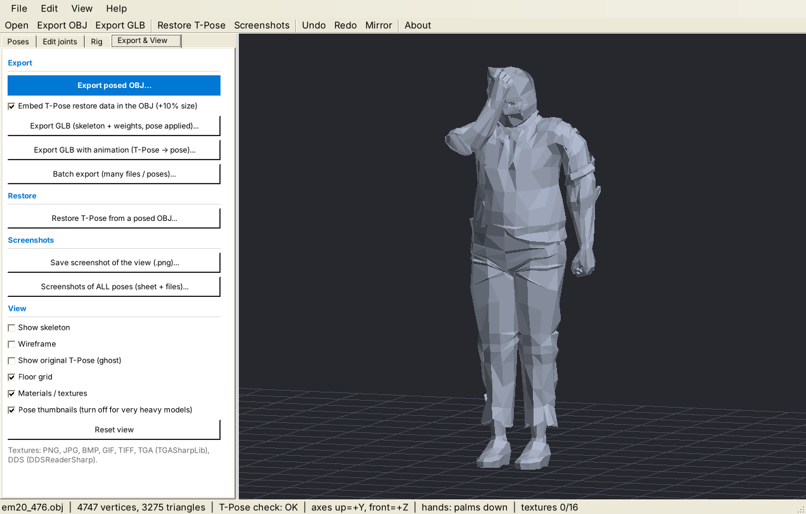
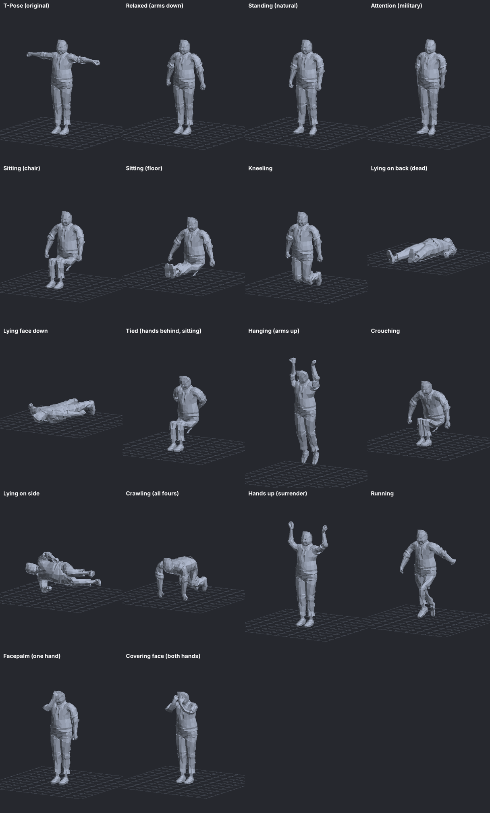
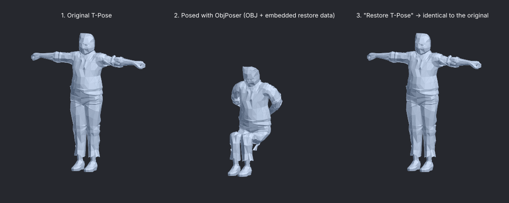

<div align="center">

[English](README.md) | **العربية**

# ObjPoser

### حوّل أي ملف `.obj` لشخصية بوضعية T-Pose إلى وضعيات جاهزة، وعدّل كل إصبع ومفصل وعظمة في الوجه، ثم صدّر OBJ بالوضعية أو GLB فيه عظام.

[](LICENSE)
[](https://github.com/YEMENI-modder/ObjPoser/actions/workflows/build.yml)


[](https://github.com/YEMENI-modder/ObjPoser/releases)
[](https://github.com/YEMENI-modder/ObjPoser/stargazers)
[](https://github.com/YEMENI-modder/ObjPoser/issues)
[](https://github.com/YEMENI-modder/ObjPoser/commits/main)




*الواجهة الرئيسية مع موديل شخصية من Resident Evil 4 (شوف [ملاحظة الصور](#ملاحظة-عن-الصور)).*

</div>

---

<div dir="rtl" align="right">

## المحتويات
[الميزات](#الميزات) · [الصور](#الصور) · [البداية السريعة](#البداية-السريعة) · [إرجاع OBJ إلى T-Pose](#إرجاع-obj-بوضعية-إلى-t-pose) · [لقطات لكل الوضعيات](#لقطات-لكل-الوضعيات) · [الوضعيات](#الوضعيات) · [الهيكل العظمي](#الهيكل-العظمي-69-مفصل) · [الملفات المدعومة](#الملفات-المدعومة) · [البناء](#البناء) · [الاختبارات و CI](#الاختبارات-و-ci) · [القيود](#القيود-المعروفة) · [الحقوق](#الحقوق-والشكر) · [الرخصة](#الرخصة)

## الميزات
- **Rig تلقائي بـ 69 مفصل**: العمود الفقري، الترقوة، الذراعين، الرجلين، **5 أصابع × 3 عظام لكل يد**، **5 أصابع لكل رجل**، و**الفك والعينين والجفون والحواجب والأنف وزوايا الفم**. يتركّب على الشبكة من نسب الجسم، بدون ذكاء اصطناعي وبدون إنترنت وبدون تثبيت.
- **18 وضعية جاهزة** (وقوف، اعتدال، جلوس، استلقاء، ركوع، مربوط، معلّق، Facepalm...) تظهر في **معرض وضعيات بصور مصغّرة**.
- **تعديل عميق**: اختر أي مفصل وعدّل الدوران **والإزاحة** بالسلايدرز، تعديل متناظر، Undo / Redo، عكس الوضعية (Mirror)، دمج وضعيتين، وضعيات جاهزة لليد، تعابير الوجه، وحفظ وتحميل الوضعيات بصيغة JSON.
- **إرجاع T-Pose**: ترجّع أي OBJ مُصدَّر بوضعية إلى T-Pose الأصلية بالضبط.
- **لقطات لكل الوضعيات** بضغطة وحدة (صورة جامعة + صورة لكل وضعية).
- **استيراد ذكي**: يكتشف المحور العمودي واتجاه الوجه، يحذّرك لو الملف مو T-Pose، ويكتشف اتجاه الكفّ.
- **Skinning**: أوزان ناعمة حسب المسافة (رؤوس لحامات الـ UV تتوحّد فما تتمزق الشبكة)، مع Linear Blend أو **Dual Quaternion**.
- **معاينة**: تدوير وتكبير، عرض الهيكل، ظل شفاف للـ T-Pose الأصلية، أرضية، Wireframe، ألوان المواد و**التكستشر (PNG, JPG, BMP, GIF, TIFF, TGA, DDS)**.
- **تصدير**: **OBJ** بالوضعية (الـ UV والمواد والمجموعات تبقى كما هي)، و**GLB** فيه هيكل وأوزان (الوضعية مطبّقة، أو **أنميشن من T-Pose إلى الوضعية**)، و**تصدير دفعة** (ملفات كثيرة × وضعيات كثيرة).
- ملف `.exe` واحد و**بدون اعتماديات** (مكتبتا التكستشر مضمّنتان بكودهما MIT).

## الصور
</div>

| معرض الوضعيات | تعديل كل مفصل (أصابع، رجل، وجه...) |
|---|---|
|  |  |
| **أدوات الـ Rig** (DQS، الأوزان، تحريك المفاصل) | **التصدير والاسترجاع واللقطات** |
|  |  |

<div dir="rtl" align="right">

### الـ 18 وضعية (طالعة من الأداة نفسها بزر *لقطات لكل الوضعيات*)
</div>



<div dir="rtl" align="right">

### ملاحظة عن الصور
الصور تستخدم موديل شخصية من لعبة *Resident Evil 4* (&copy; CAPCOM) فقط لعرض الأداة. **ملف الموديل نفسه مو موجود في المستودع.** الملف `samples/sample_tpose.obj` شخصية بسيطة تقدر تجرّب عليها.

## البداية السريعة
1. نزّل `ObjPoser-windows.zip` من صفحة [Releases](https://github.com/YEMENI-modder/ObjPoser/releases) (أو ابنِ المشروع، شوف [البناء](#البناء)) وشغّل `ObjPoser.exe`. يحتاج ويندوز مع .NET Framework 4.8 (موجود في ويندوز 10 / 11 الحديث).
2. **Open OBJ**: اختر شخصية واقفة بوضعية T-Pose (الذراعين أفقيين). جرّب `samples/sample_tpose.obj`.
3. اختر وضعية من معرض **Poses**. عدّل بدقة من **Edit joints** (دوران، إزاحة، وضعيات اليد، تعابير الوجه).
4. **Export posed OBJ** (أو GLB). خلاص.

داخل الأداة: يسار الشخصية = +X والوجه = +Z. الماوس: سحب = تدوير، عجلة = تكبير.

| الاختصار | الوظيفة | الاختصار | الوظيفة |
|---|---|---|---|
| `Ctrl+O` | فتح OBJ | `Ctrl+Z` / `Ctrl+Y` | تراجع / إعادة |
| `Ctrl+E` | تصدير OBJ | `Ctrl+M` | عكس الوضعية |
| `Ctrl+G` | تصدير GLB | `Ctrl+T` | إرجاع T-Pose |
| `F5` | لقطات لكل الوضعيات | `F12` | لقطة للمعاينة |

## إرجاع OBJ بوضعية إلى T-Pose
</div>



<div dir="rtl" align="right">

- عند تصدير OBJ تقدر الأداة تضمّن فيه **T-Pose الأصلية** (أسطر تعليقات تبدأ بـ `# OBJPOSER-`، تزيد الحجم حوالي 10%، وأي برنامج OBJ يتجاهلها). فعّل أو عطّل *Embed T-Pose restore data* من تبويب **Export & View**.
- **File > Restore T-Pose from a posed OBJ...** (`Ctrl+T`) يرجّع T-Pose الأصلية **بالضبط** (الرؤوس والنورمالز، أما الوجوه والـ UV والمواد فما تتغير).
- لو الملف ما فيه بيانات استرجاع، تقدر تختار **ملف T-Pose الأصلي لنفس الموديل** (نفس ترتيب الرؤوس) والأداة ترجّع منه.
- لو فتحت ملف سبق وعملت له وضعية بالأداة، تسألك تحمّل T-Pose الأصلية مباشرة.
- غير ممكن: إرجاع OBJ ثبّتّه برنامج ثاني بوضعية، لأن الشكل الأصلي مجهول.

## لقطات لكل الوضعيات
*File > Screenshots of all poses* (`F5`) أو الزر في تبويب **Export & View**: اختر مجلد وتطلع لك `poses_sheet.png` (كل الوضعيات في صورة وحدة مثل اللي فوق) مع `pose_01_...png` و`pose_02_...png`... صورة لكل وضعية، بموديلك أنت (والتكستشر يظهر لو *Materials / textures* شغّال).

## الوضعيات
</div>

| | | | |
|---|---|---|---|
| T-Pose (الأصلية) | Relaxed (ذراعين نازلة) | **Standing (وقوف طبيعي)** | **Attention (اعتدال)** |
| Sitting (كرسي) | Sitting (أرض) | Kneeling (ركوع) | Lying on back (ميت) |
| Lying face down | Tied (مربوط، اليدين خلف الظهر) | Hanging (معلّق) | Crouching |
| Lying on side | Crawling (زحف) | Hands up (استسلام) | Running (جري) |
| **Facepalm (يد وحدة)** | **تغطية الوجه (باليدين)** | | |

<div dir="rtl" align="right">

تقدر تضيف وضعياتك: عدّل أي وضعية، **Save pose (.json)**، وحمّلها بعدين بـ **Load pose** (تظهر في المعرض).

## الهيكل العظمي (69 مفصل)
</div>

| المجموعة | المفاصل |
|---|---|
| الجسم (19) | Hips, Spine, Chest, Neck, Head, L/R Clavicle, UpperArm, ForeArm, Hand, Thigh, Shin, Foot |
| الوجه (10) | Jaw, L/R Eye, L/R Eyelid, L/R Brow, Nose, L/R Mouth corner |
| الأصابع (30) | Thumb, Index, Middle, Ring, Pinky × 3 عظام × يدين |
| أصابع الرجل (10) | 5 أصابع × رجلين |

<div dir="rtl" align="right">

اليدين والأصابع وأصابع الرجل تستخدم إطار الكفّ، فعلى كل إصبع **Z = ثني (Curl)**. عظام الوجه تُقدَّر من شكل الرأس؛ وكثير من موديلات الألعاب ترسم العين والفم على التكستشر، فهذي العظام تحرّك فقط اللي موجود فعلاً في الشبكة (الفك والأنف والحواجب غالباً تشتغل).

## الملفات المدعومة
</div>

| | الصيغ |
|---|---|
| موديل (إدخال) | `.obj` (مثلثات / رباعيات / مضلعات، `v/vt/vn`، فهارس سالبة، `usemtl`، `.mtl`) |
| موديل (إخراج) | `.obj` بالوضعية، `.glb` (glTF 2.0 فيه هيكل وأوزان وأنميشن اختياري) |
| تكستشر | `.png` `.jpg` `.bmp` `.gif` `.tif` (System.Drawing)، `.tga` (**TGASharpLib**)، `.dds` DXT1-5 وغير المضغوط (**DDSReaderSharp**) |
| وضعيات | `.json` |

<div dir="rtl" align="right">

## البناء
المتطلبات: ويندوز و .NET Framework 4.8. **بدون حزم NuGet.**

- **بدون Visual Studio**: شغّل `build.bat` (يستخدم مترجم C# الموجود في ويندوز) فيطلع `ObjPoser.exe`.
- **Visual Studio / MSBuild**: افتح `src/ObjPoser.csproj` وابنِ (الهدف .NET Framework 4.8).
- **Mono** (لينكس / ماك): `mcs -target:winexe -r:System.Windows.Forms.dll -r:System.Drawing.dll -out:ObjPoser.exe src/*.cs src/ThirdParty/*.cs`

## الاختبارات و CI
</div>

```
csc /out:selftest.exe tests\CoreSelfTest.cs src\Core.cs src\Skeleton.cs src\Pose.cs src\Skinner.cs src\Export.cs
selftest.exe samples\sample_tpose.obj
```

<div dir="rtl" align="right">

الاختبار الذاتي يفحص كشف المحاور، فحص الـ T-Pose، كل الوضعيات (LBS و DQS)، JSON الوضعيات، الـ Mirror، تصدير OBJ، إرجاع T-Pose، وملفات GLB؛ ويرجع كود خروج 0 لو كل شي نجح.

ملف GitHub Actions ‏[`.github/workflows/build.yml`](.github/workflows/build.yml) يبني المشروع على `windows-latest` ويشغّل الاختبار ويرفع `ObjPoser-windows.zip`؛ ولو دفعت Tag مثل `v3.1.0` ينشر Release تلقائياً.

للـ AI والمطورين الجدد: اقرأ [`AGENTS.md`](AGENTS.md) (الهيكلة، الاصطلاحات، كيف تطوّر وتختبر).

## القيود المعروفة
- الـ rig تقديري: يتوقع شخصية بشرية واقفة وذراعينها على محور X. الملابس الواسعة والشعر الطويل والمخلوقات والموديلات قليلة الرؤوس ممكن تحتاج تعديل المفاصل (تبويب **Rig**: تحريك المفاصل، اتجاه الكفّ، التنعيم).
- الـ Skinning تقريب هندسي: توقع بعض التشوه عند الكتف والإبط والورك في الوضعيات القوية. الشبكة ما تُقسَّم.
- DDS: DXT1-5 والصيغ غير المضغوطة الشائعة (بدون BC4 / BC5 / BC7 / ترويسة DX10).
- وضعية الجلوس بدون كرسي، والتعليق بدون حبل. تصدير GLB بمحاور الأداة (Y لأعلى والوجه +Z) وبدون مواد / تكستشر.
- زوايا Facepalm وتغطية الوجه محسوبة لشخصية بشرية عادية؛ عدّلها للنسب الثانية.
- إرجاع T-Pose يشتغل للملفات المصدّرة من ObjPoser (بيانات مضمّنة) أو مع ملف T-Pose مرجعي.
- تم التطوير والاختبار على Mono (لينكس) وباختبارات آلية؛ لو واجهت مشكلة خاصة بويندوز بلّغ عنها في [Issues](https://github.com/YEMENI-modder/ObjPoser/issues).

## الحقوق والشكر
**صاحب الأداة:** [**YEMENI-modder**](https://github.com/YEMENI-modder). أنشأها ونشرها YEMENI-modder، &copy; 2026 YEMENI. الأفكار والمتطلبات والملاحظات و**كل الاختبارات** من YEMENI-modder.

### إفصاح الذكاء الاصطناعي
> **كود هذا المشروع كُتب بالكامل بواسطة ذكاء اصطناعي: Claude Sonnet 5.5 (من Anthropic).** كل شي في المستودع (كود C#، الـ rig، الـ skinning، المصدّرات، الواجهة، الاختبارات، ملف CI، والتوثيق) أنتجه Claude Sonnet 5.5. صاحب المشروع YEMENI-modder ما كتب كود يدوياً: وجّه العمل ونفّذ الاختبارات على موديلات حقيقية.

### المكتبات الخارجية (MIT، مضمّنة كمصدر بدون تعديل)
</div>

| المكتبة | الاستخدام | المؤلف | الرابط |
|---|---|---|---|
| **TGASharpLib** | تكستشر `.tga` | Alex Green (Zelenskyi Alexandr) | https://github.com/ALEXGREENALEX/TGASharpLib |
| **DDSReaderSharp** | تكستشر `.dds` | Alex Green (Zelenskyi Alexandr)؛ نقل لـ `DDSReader.java` من Kenji Sasaki | https://github.com/ALEXGREENALEX/DDSReaderSharp |

<div dir="rtl" align="right">

النصوص الكاملة: [`THIRD_PARTY_NOTICES.md`](THIRD_PARTY_NOTICES.md) وملفات الرخص في [`src/ThirdParty/`](src/ThirdParty/).

### العلامات التجارية
*Resident Evil* علامة تجارية وحقوق &copy; لشركة CAPCOM Co., Ltd. هذا المشروع غير تابع لـ CAPCOM وغير معتمد منها، وأداة ObjPoser لا تحتوي ولا توزّع أي ملف من اللعبة.

## الرخصة
[MIT](LICENSE) &copy; 2026 YEMENI.

</div>
