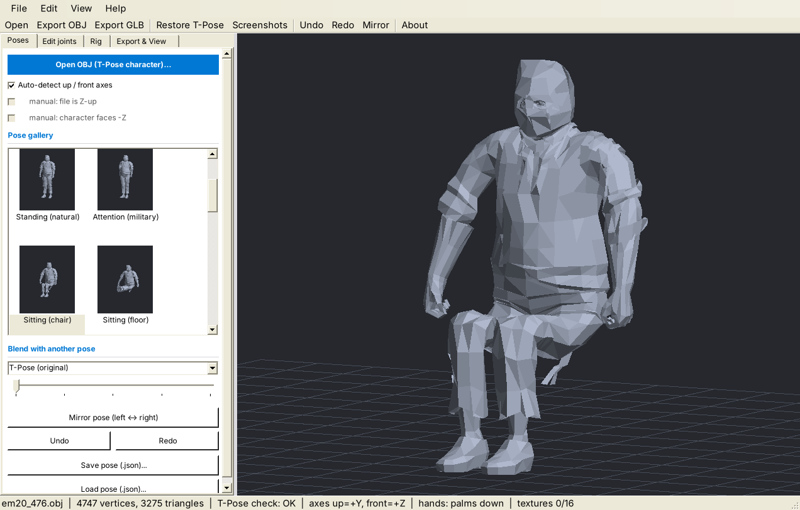
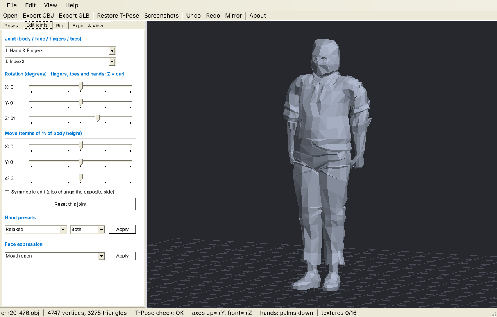
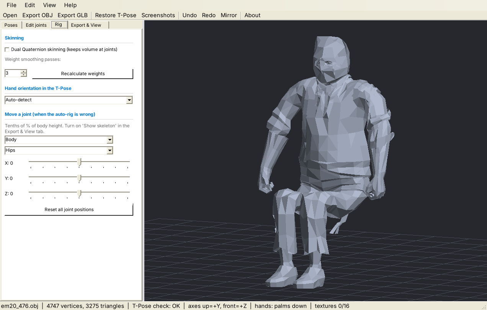
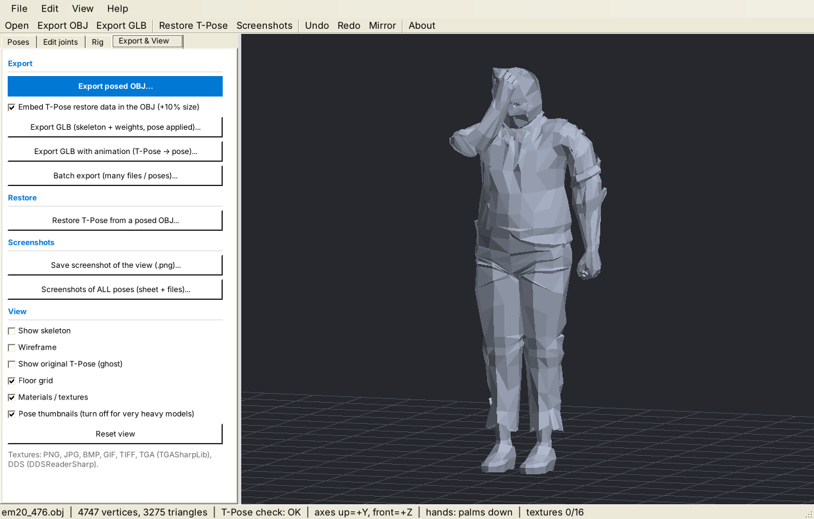
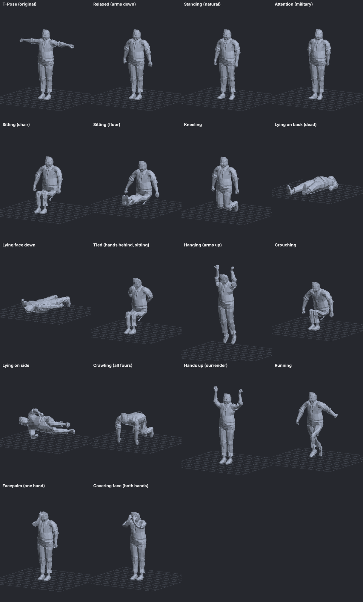
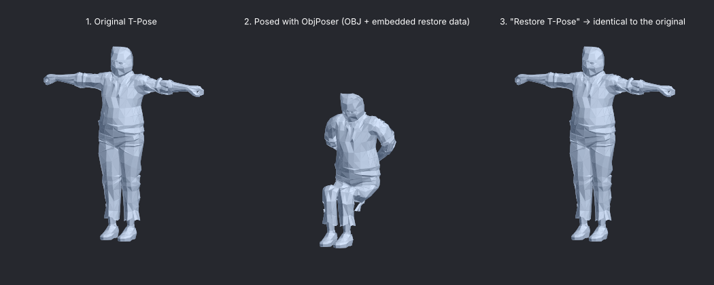

<div align="center">

**English** | [العربية](README.ar.md)

# ObjPoser

### Turn any T-Pose character `.obj` into a pose, edit every finger, toe and face bone, then export a posed OBJ or a rigged GLB.

[](LICENSE)
[](https://github.com/YEMENI-modder/ObjPoser/actions/workflows/build.yml)


[](https://github.com/YEMENI-modder/ObjPoser/releases)
[](https://github.com/YEMENI-modder/ObjPoser/stargazers)
[](https://github.com/YEMENI-modder/ObjPoser/issues)
[](https://github.com/YEMENI-modder/ObjPoser/commits/main)




*Main window with a Resident Evil 4 character model (see [Screenshots note](#screenshots-note)).*

</div>

---

## Table of contents
[Features](#features) · [Screenshots](#screenshots) · [Quick start](#quick-start) · [Restore a posed OBJ back to T-Pose](#restore-a-posed-obj-back-to-t-pose) · [Screenshots of all poses](#screenshots-of-all-poses) · [Poses](#poses) · [Skeleton](#skeleton-69-joints) · [Supported files](#supported-files) · [Build](#build) · [Tests and CI](#tests-and-ci) · [Limitations](#known-limitations) · [Credits](#credits-and-rights) · [License](#license)

## Features
- **Automatic rig with 69 joints**: spine, clavicles, arms, legs, **5 fingers x 3 bones per hand**, **5 toes per foot**, **jaw, eyes, eyelids, brows, nose and mouth corners**. It is fitted to the mesh from its proportions: no AI model, no internet, no install.
- **18 ready poses** (standing, attention, sitting, lying, kneeling, tied, hanging, facepalm...) shown in a **pose gallery with thumbnails**.
- **Deep editing**: pick any joint, edit rotation *and* translation with sliders, symmetric edit, undo / redo, mirror pose, blend two poses, hand presets, face expressions, save / load poses as JSON.
- **Restore T-Pose**: bring a posed OBJ back to the exact original T-Pose.
- **Screenshots of all poses** in one click (a sheet + one PNG per pose).
- **Smart import**: detects up / front axes, warns when the file is not a T-Pose, detects the palm orientation.
- **Skinning**: smoothed distance weights (UV-seam vertices are welded so they never tear), Linear Blend or **Dual Quaternion** skinning.
- **Preview**: orbit / zoom, skeleton overlay, ghost of the original T-Pose, floor grid, wireframe, MTL colours and **textures (PNG, JPG, BMP, GIF, TIFF, TGA, DDS)**.
- **Export**: posed **OBJ** (UVs, materials and groups are kept unchanged), **GLB** with skeleton + skin weights (pose applied, or an **animation T-Pose -> pose**), and **batch export** (many files x many poses).
- Single `.exe`, **no dependencies** (the two texture libraries are bundled as MIT source code).

## Screenshots
| Pose gallery | Edit every joint (fingers, toes, face...) |
|---|---|
|  |  |
| **Rig tools** (DQS, weights, move joints) | **Export, restore and screenshots** |
|  |  |

### All 18 poses (generated by the tool itself with *Screenshots of ALL poses*)


### Screenshots note
The screenshots use a character model from *Resident Evil 4* (&copy; CAPCOM) only to demonstrate the tool. **The model file is not part of this repository.** `samples/sample_tpose.obj` is a simple figure that you can use to try the tool.

## Quick start
1. Download `ObjPoser-windows.zip` from the [Releases](https://github.com/YEMENI-modder/ObjPoser/releases) page (or build it, see [Build](#build)) and run `ObjPoser.exe`. Requires Windows with .NET Framework 4.8 (included in current Windows 10 / 11).
2. **Open OBJ**: pick a character standing in a T-Pose (arms horizontal). Try `samples/sample_tpose.obj`.
3. Choose a pose in the **Poses** gallery. Fine-tune in **Edit joints** (rotation, translation, hand presets, face expressions).
4. **Export posed OBJ** (or GLB). Done.

Inside the tool the left side of the character is +X and the front is +Z. Mouse: drag = rotate, wheel = zoom.

| Shortcut | Action | Shortcut | Action |
|---|---|---|---|
| `Ctrl+O` | open OBJ | `Ctrl+Z` / `Ctrl+Y` | undo / redo |
| `Ctrl+E` | export OBJ | `Ctrl+M` | mirror pose |
| `Ctrl+G` | export GLB | `Ctrl+T` | restore T-Pose |
| `F5` | screenshots of all poses | `F12` | screenshot of the view |

## Restore a posed OBJ back to T-Pose


- When you export an OBJ, ObjPoser can embed the **original T-Pose** in it (comment lines starting with `# OBJPOSER-`, about +10 % file size; any OBJ viewer ignores them). Tick / untick *Embed T-Pose restore data* in **Export & View**.
- **File > Restore T-Pose from a posed OBJ...** (`Ctrl+T`) writes the original T-Pose back, **exactly** (vertices and normals; faces, UVs and materials are untouched).
- If the file has no restore data you can pick the **original T-Pose OBJ of the same model** (same vertex order) and the tool restores from it.
- Opening a file that was posed by ObjPoser offers to load its original T-Pose directly.
- Not possible: un-posing an arbitrary OBJ posed by other software, because the original shape is unknown.

## Screenshots of all poses
*File > Screenshots of all poses* (`F5`) or the button in **Export & View**: choose a folder and you get `poses_sheet.png` (all poses on one image, like the one above) plus `pose_01_...png`, `pose_02_...png`... one PNG per pose, rendered with your model (textures included when *Materials / textures* is on).

## Poses
| | | | |
|---|---|---|---|
| T-Pose (original) | Relaxed (arms down) | **Standing (natural)** | **Attention (military)** |
| Sitting (chair) | Sitting (floor) | Kneeling | Lying on back (dead) |
| Lying face down | Tied (hands behind, sitting) | Hanging (arms up) | Crouching |
| Lying on side | Crawling (all fours) | Hands up (surrender) | Running |
| **Facepalm (one hand)** | **Covering face (both hands)** | | |

You can add your own: edit any pose, **Save pose (.json)**, and **Load pose** later (loaded poses appear in the gallery).

## Skeleton (69 joints)
| Group | Joints |
|---|---|
| Body (19) | Hips, Spine, Chest, Neck, Head, L/R Clavicle, UpperArm, ForeArm, Hand, Thigh, Shin, Foot |
| Face (10) | Jaw, L/R Eye, L/R Eyelid, L/R Brow, Nose, L/R Mouth corner |
| Fingers (30) | Thumb, Index, Middle, Ring, Pinky x 3 bones x 2 hands |
| Toes (10) | 5 toes x 2 feet |

Hands, fingers and toes use a palm frame, so on every finger **Z = curl**. Face bones are estimated from the head geometry; many game models paint eyes and mouth on a texture, so those bones only move what the mesh actually contains (jaw, nose and brows usually work).

## Supported files
| | Formats |
|---|---|
| Model in | `.obj` (triangles / quads / n-gons, `v/vt/vn`, negative indices, `usemtl`, `.mtl`) |
| Model out | posed `.obj`, `.glb` (glTF 2.0 binary with skeleton, weights, optional animation) |
| Textures | `.png` `.jpg` `.bmp` `.gif` `.tif` (System.Drawing), `.tga` (**TGASharpLib**), `.dds` DXT1-5 + uncompressed (**DDSReaderSharp**) |
| Poses | `.json` (see `Pose.ToJson`) |

## Build
Requirements: Windows, .NET Framework 4.8. **No NuGet packages.**

- **Without Visual Studio**: run `build.bat` (uses the C# compiler that ships with Windows) -> `ObjPoser.exe`.
- **Visual Studio / MSBuild**: open `src/ObjPoser.csproj` and build (target .NET Framework 4.8).
- **Mono** (Linux / macOS): `mcs -target:winexe -r:System.Windows.Forms.dll -r:System.Drawing.dll -out:ObjPoser.exe src/*.cs src/ThirdParty/*.cs`

## Tests and CI
```
csc /out:selftest.exe tests\CoreSelfTest.cs src\Core.cs src\Skeleton.cs src\Pose.cs src\Skinner.cs src\Export.cs
selftest.exe samples\sample_tpose.obj
```
The self-test checks axis detection, the T-Pose check, all poses (LBS and DQS), pose JSON, mirror, OBJ export, restore-to-T-Pose and GLB containers; it returns exit code 0 when everything passes.

The GitHub Actions workflow [`.github/workflows/build.yml`](.github/workflows/build.yml) builds the project on `windows-latest`, runs the self-test and uploads `ObjPoser-windows.zip`; pushing a tag like `v3.1.0` also publishes a GitHub release.

AI agents and new contributors: read [`AGENTS.md`](AGENTS.md) (architecture, conventions, how to extend and test).

## Known limitations
- The rig is heuristic: it expects a standing humanoid with arms along the X axis. Loose clothing, long hair, creatures and very low-poly meshes may need joint tweaks (**Rig** tab: move joints, palm orientation, smoothing).
- Skinning is a geometric approximation: expect some deformation at shoulders, armpits and hips in strong poses. Meshes are not subdivided.
- DDS: DXT1-5 and common uncompressed formats (no BC4 / BC5 / BC7 / DX10 headers).
- "Sitting" has no chair and "hanging" has no rope. GLB export is written in working space (Y-up, front +Z) without materials / textures.
- Facepalm / face-covering angles were solved for a typical humanoid; fine-tune them for other proportions.
- Restore T-Pose works for files posed by ObjPoser (embedded data) or with a reference T-Pose file.
- Developed and tested on Mono (Linux, Xvfb) and with automated tests; please report Windows-specific problems in the [issues](https://github.com/YEMENI-modder/ObjPoser/issues).

## Credits and rights
**Author / owner:** [**YEMENI-modder**](https://github.com/YEMENI-modder). Created and published by YEMENI-modder, &copy; 2026 YEMENI. Project ideas, requirements, feedback and **all testing** by YEMENI-modder.

### AI disclosure
> **The source code of this project was written entirely by an AI: Claude Sonnet 5.5 (by Anthropic).** Everything in this repository (the C# code, the rig, the skinning, the exporters, the UI, the tests, the CI workflow and the documentation) was generated by Claude Sonnet 5.5. YEMENI-modder did not write code by hand: he directed the work and ran the tests on real models.

### Third-party libraries (MIT, bundled as source, unmodified)
| Library | Used for | Author | Link |
|---|---|---|---|
| **TGASharpLib** | `.tga` textures | Alex Green (Zelenskyi Alexandr) | https://github.com/ALEXGREENALEX/TGASharpLib |
| **DDSReaderSharp** | `.dds` textures | Alex Green (Zelenskyi Alexandr); port of `DDSReader.java` by Kenji Sasaki | https://github.com/ALEXGREENALEX/DDSReaderSharp |

Full texts: [`THIRD_PARTY_NOTICES.md`](THIRD_PARTY_NOTICES.md) and the license files in [`src/ThirdParty/`](src/ThirdParty/).

### Trademarks
*Resident Evil* is a trademark and &copy; of CAPCOM Co., Ltd. This project is not affiliated with or endorsed by CAPCOM. ObjPoser does not contain or distribute any game asset.

## License
[MIT](LICENSE) &copy; 2026 YEMENI.
