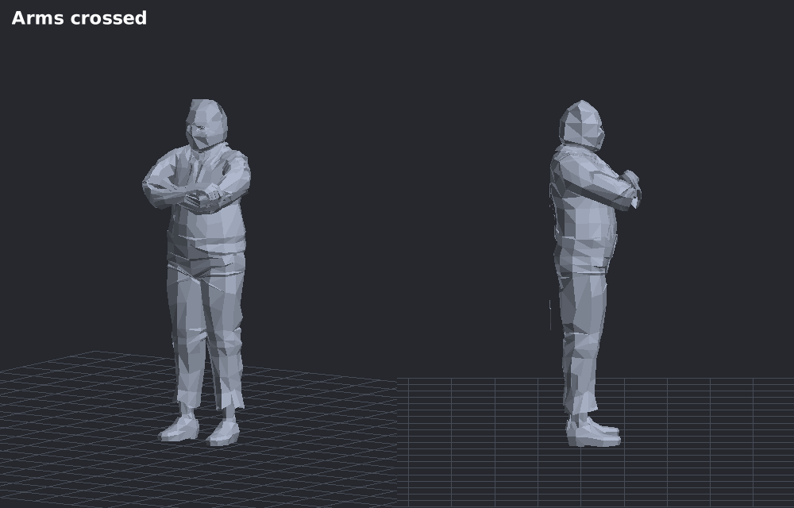
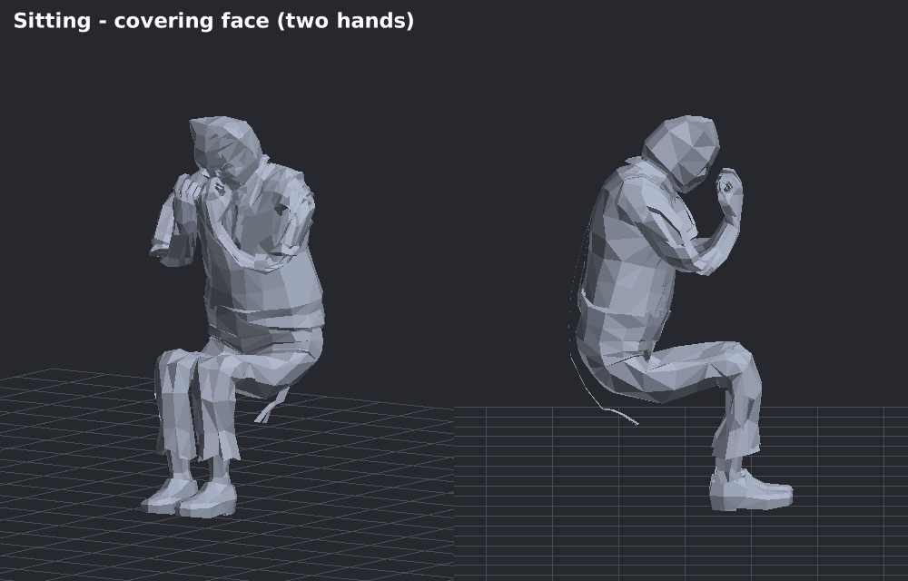
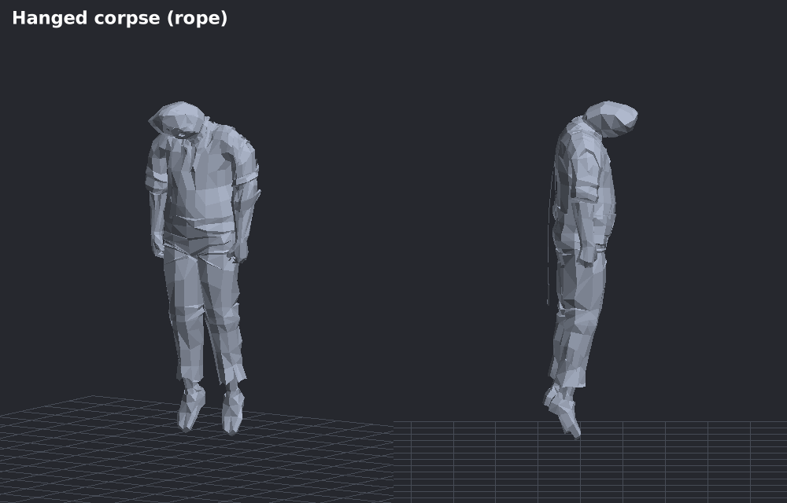
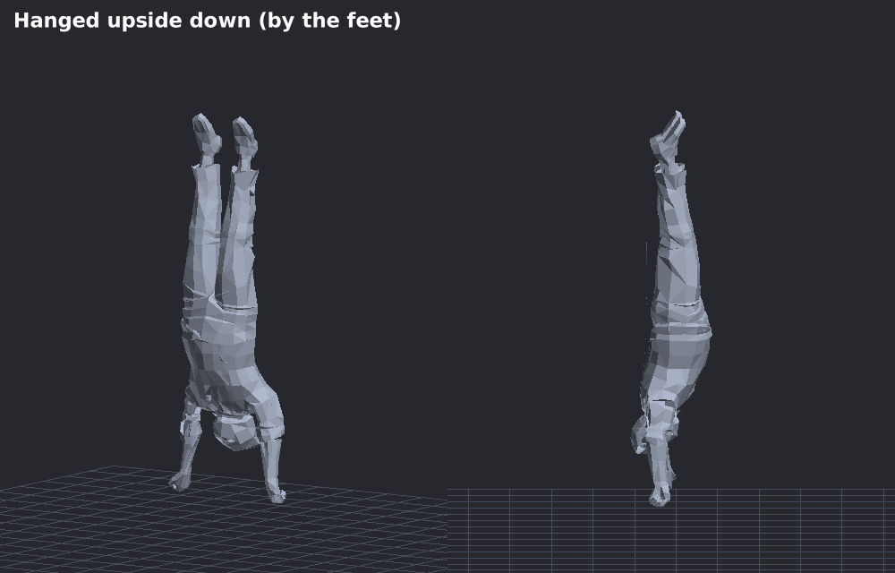
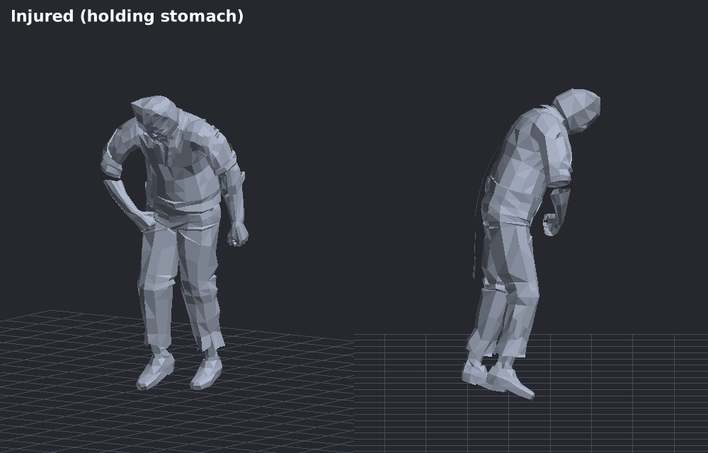
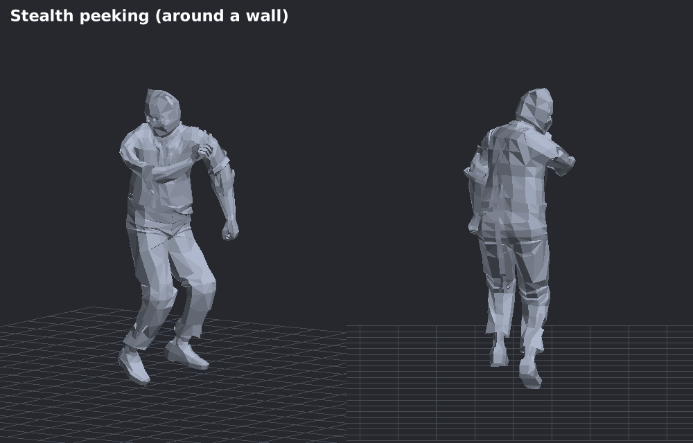
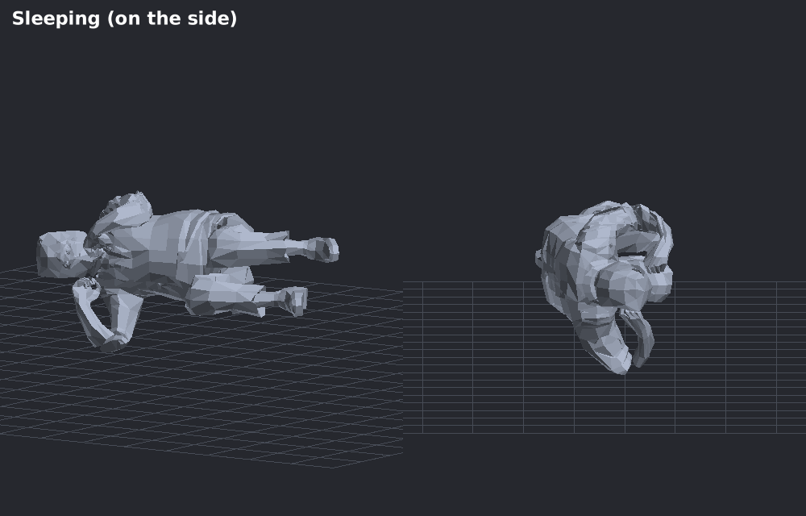
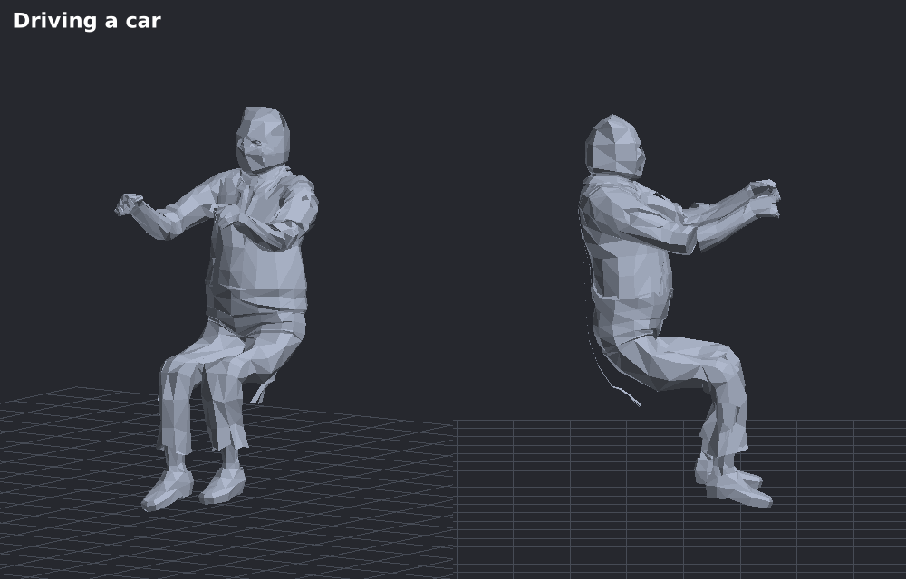
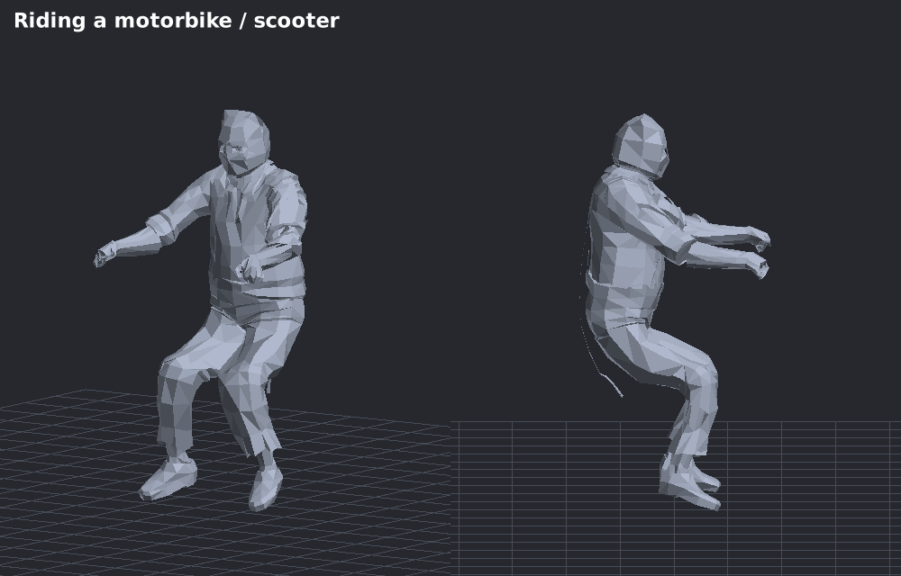

# Extra poses (JSON)

Nine extra poses that are **not built into the program**. ObjPoser loads every `*.json` file of this folder when it starts and adds the poses to the gallery (the folder must sit next to `ObjPoser.exe`; the release zip and the Visual Studio build already put it there). You can also load a single file at any time with *Edit > Load pose...*.

Add your own: edit a pose, **Save pose (.json)**, put the file in this folder and restart. The *Edit > Open extra poses folder...* menu opens the folder.

*(بالعربي: هذي وضعيات إضافية مو مدموجة بالتطبيق. التطبيق يقرأ كل ملفات `*.json` في هذا المجلد عند التشغيل ويضيفها للمعرض. تقدر تضيف وضعياتك بحفظها بـ Save pose ورميها هنا.)*

| Pose | الوضعية | File |
|---|---|---|
| Arms crossed | مكتوف اليدين | `arms_crossed.json` |
| Sitting - covering face (two hands) | جلوس وتغطية الوجه باليدين (مثل بوبي فيشر) | `sitting_covering_face_two_hands.json` |
| Hanged corpse (rope) | جثة معلّقة بحبل | `hanged_corpse.json` |
| Hanged upside down (by the feet) | جثة معلّقة بحبل مقلوبة (الرجلين فوق والراس تحت) | `hanged_upside_down.json` |
| Injured (holding stomach) | شخص مصاب | `injured_holding_stomach.json` |
| Stealth peeking (around a wall) | وضعية التخفي (يطالع من طرف الجدار) | `stealth_peeking_wall.json` |
| Sleeping (on the side) | النوم | `sleeping_on_side.json` |
| Driving a car | سواقة السيارة | `driving_car.json` |
| Riding a motorbike / scooter | سواقة الدباب | `riding_scooter.json` |

### Arms crossed - مكتوف اليدين

### Sitting - covering face (two hands) - جلوس وتغطية الوجه باليدين (مثل بوبي فيشر)

### Hanged corpse (rope) - جثة معلّقة بحبل

### Hanged upside down (by the feet) - جثة معلّقة بحبل مقلوبة (الرجلين فوق والراس تحت)

### Injured (holding stomach) - شخص مصاب

### Stealth peeking (around a wall) - وضعية التخفي (يطالع من طرف الجدار)

### Sleeping (on the side) - النوم

### Driving a car - سواقة السيارة

### Riding a motorbike / scooter - سواقة الدباب

## Notes
- The preview images were rendered with ObjPoser itself on a character model from *Resident Evil 4* (&copy; CAPCOM) only to show the poses; the model is **not** part of this repository.
- Poses are rotations of the 69 joints (degrees, see `AGENTS.md`), so they work on any humanoid T-Pose model. Arm / hand targets (face, wheel, handlebar, stomach...) were solved on one model: on a character with very different proportions fine-tune them with the *Edit joints* sliders.
- Chairs, cars, motorbikes, ropes and walls are **not** part of the poses: put the character on your own prop; the pose only moves the body (`snapToGround` puts the lowest point on the floor, `liftHeightFraction` lifts the hanged poses off the floor).
- Regenerate / extend them with `tools/PoseGen.cs`.
